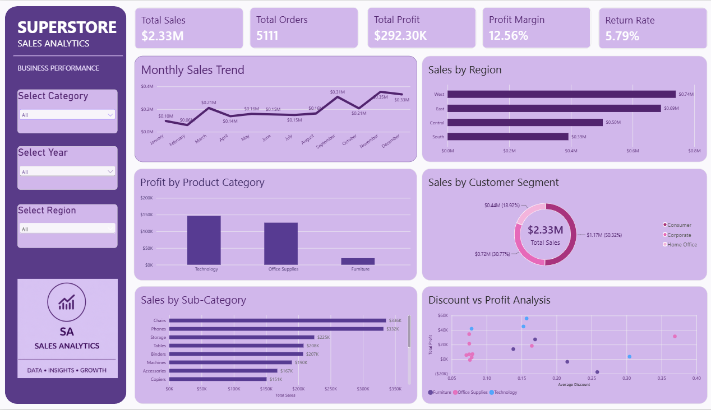

# Superstore Sales Analytics Dashboard

## Project Overview
An interactive Sales Analytics Dashboard developed using Microsoft Power BI to analyze sales performance, profitability, customer segments, and regional trends using the Superstore dataset.

## Tools & Technologies
- Microsoft Power BI
- Microsoft Excel
- DAX (Data Analysis Expressions)

## Key Performance Indicators (KPIs)
- **Total Sales:** $2.33M
- **Total Orders:** 5,111
- **Total Profit:** $292.30K
- **Profit Margin:** 12.56%
- **Return Rate:** 5.79%

## Dashboard Features
- Monthly Sales Trend
- Sales by Region
- Profit by Product Category
- Sales by Customer Segment
- Sales by Sub-Category
- Discount vs Profit Analysis
- Interactive slicers for Year, Category, and Region

## Data Model
The report uses three tables:
- Orders
- People
- Returns

Relationships were created to support interactive analysis across the tables.

## Dashboard Preview

## Business Questions
This dashboard explores the following business questions:

- How do sales change over time?
- Which regions generate the highest sales?
- Which product categories contribute the most profit?
- Which customer segment generates the highest revenue?
- How do discounts relate to profitability?
- Which product sub-categories perform best?

## Data Preparation & Analysis
- Formatted and organized the Superstore dataset using Excel.
- Imported Orders, People, and Returns tables into Power BI.
- Created relationships between tables.
- Developed DAX measures for key performance indicators.
- Built interactive charts and slicers for business analysis.

## Skills Demonstrated
- Data Cleaning and Preparation
- Exploratory Data Analysis
- Data Modelling
- DAX Measures
- KPI Development
- Interactive Dashboard Design
- Business Insights and Data Visualization
- 
## Future Improvements
- Add deeper customer-level analysis.
- Explore product-level profitability.
- Improve reporting with additional analytical measures.
- 
## Project Objective
To transform sales data into meaningful business insights through interactive visualizations and KPI tracking, supporting data-driven decision-making.

## Project Status
Completed

## Author
Thennarasi
